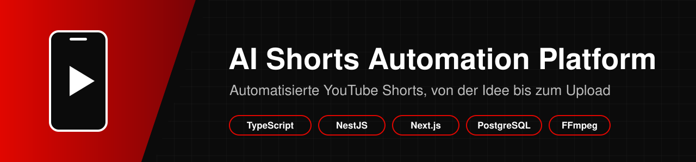
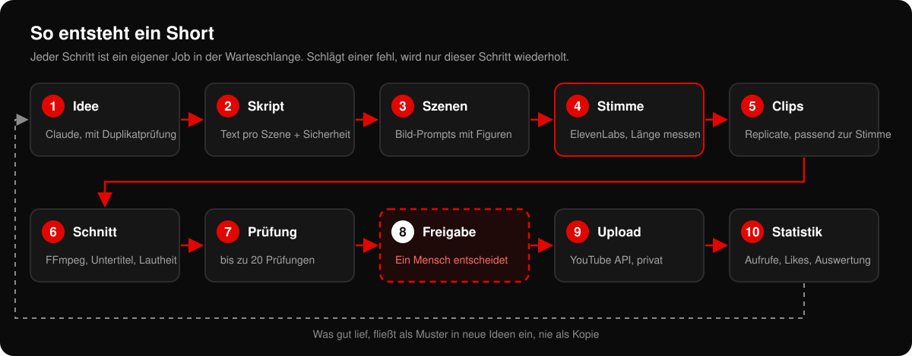
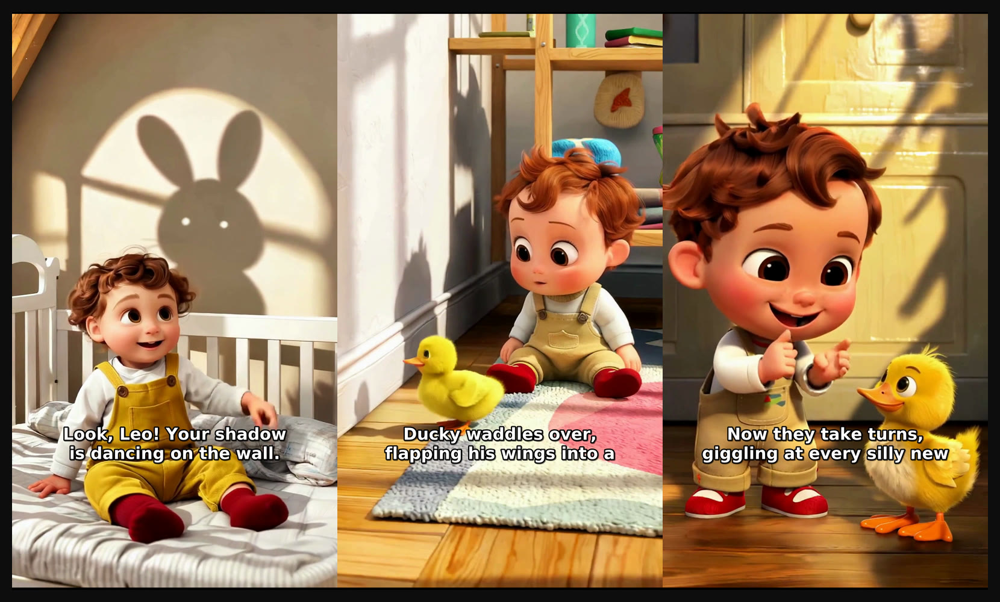
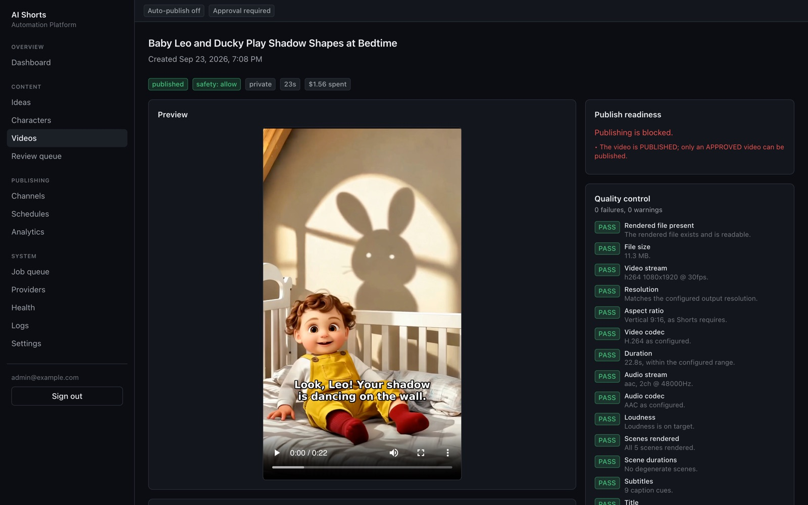
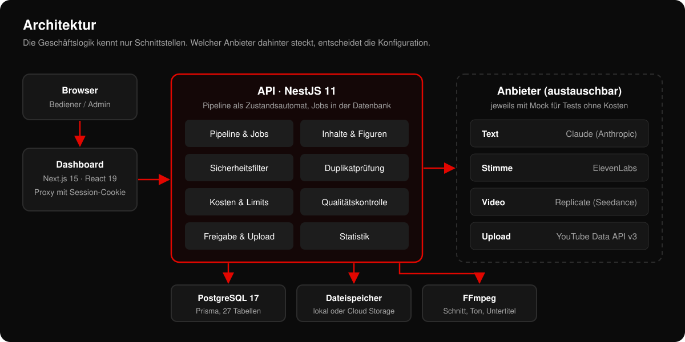
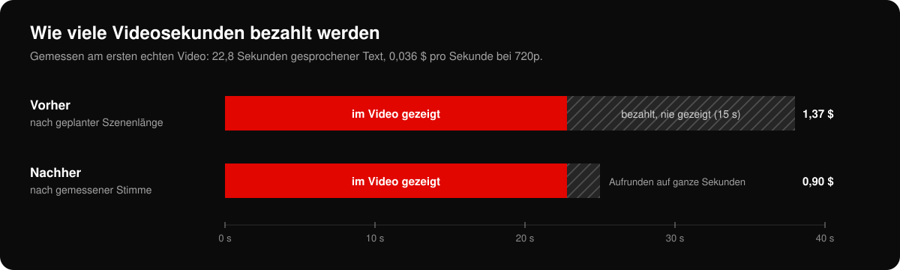
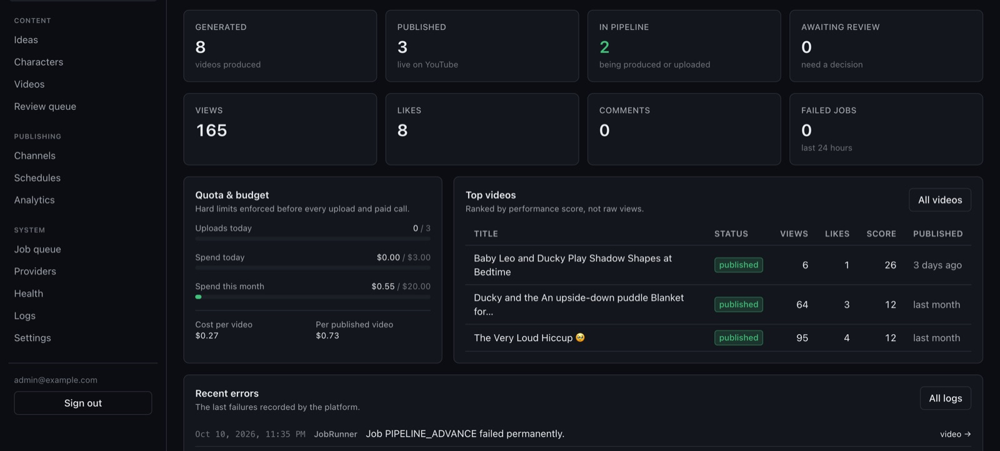
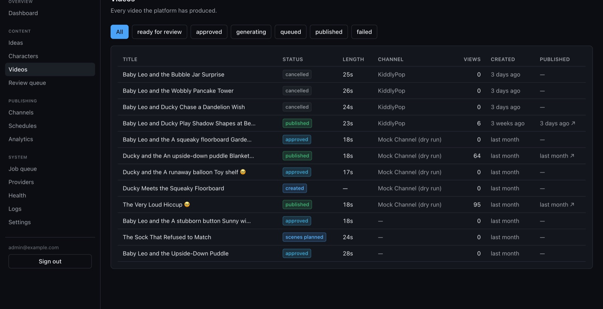
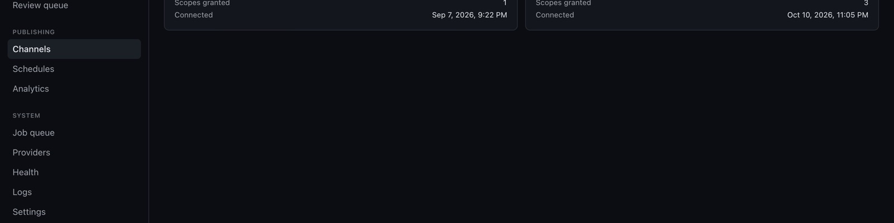
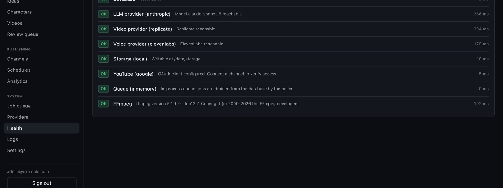

<p align="center">
  
</p>

<p align="center">
  
  
  
  
  
  
</p>

# AI Shorts Automation Platform

Eine Plattform, die kurze Hochkant-Videos für **YouTube Shorts** weitgehend automatisch
herstellt. Sie denkt sich eine Geschichte aus, schreibt das Skript, lässt eine Stimme
sprechen, erzeugt passende Bilder, schneidet alles zusammen, prüft das Ergebnis und lädt
es auf YouTube hoch. Das letzte Wort hat dabei immer ein Mensch.

Gebaut habe ich das Projekt für meinen Kanal **KiddlyPop**. Dort sollen kurze, ruhige
Geschichten mit zwei erfundenen Figuren laufen: dem Kleinkind *Baby Leo* und dem Entchen
*Ducky*.

## Inhalt

1. [Worum es geht](#1-worum-es-geht)
2. [Was die Plattform kann](#2-was-die-plattform-kann)
3. [So entsteht ein Short](#3-so-entsteht-ein-short)
4. [Ein echtes Beispiel](#4-ein-echtes-beispiel)
5. [Architektur](#5-architektur)
6. [Sicherheit und Kostenkontrolle](#6-sicherheit-und-kostenkontrolle)
7. [Qualitätskontrolle](#7-qualitätskontrolle)
8. [Probleme, die ich unterwegs gelöst habe](#8-probleme-die-ich-unterwegs-gelöst-habe)
9. [Screenshots](#9-screenshots)
10. [Kosten](#10-kosten)
11. [Technik](#11-technik)
12. [Projektstruktur](#12-projektstruktur)
13. [Installation und Start](#13-installation-und-start)
14. [Tests](#14-tests)
15. [Grenzen und nächste Schritte](#15-grenzen-und-nächste-schritte)
16. [Weitere Dokumentation](#16-weitere-dokumentation)

---

## 1. Worum es geht

Ein einzelnes Short von Hand zu produzieren heißt: Idee finden, Text schreiben, Stimme
aufnehmen, Bilder besorgen, schneiden, Untertitel setzen, Titel und Beschreibung
schreiben, hochladen. Mich hat interessiert, wie viel davon sich automatisieren lässt,
ohne die Kontrolle abzugeben und ohne dass die Kosten davonlaufen.

Drei Regeln standen von Anfang an fest:

1. **Nur eigene Inhalte.** Die Plattform hat keine Funktion, um fremde Videos von
   YouTube oder TikTok herunterzuladen. Jede Datei wird mit Herkunft und Lizenz
   gespeichert.
2. **Nichts geht ungeprüft online.** Im Auslieferungszustand läuft alles im Testmodus,
   und jedes Video braucht eine Freigabe durch einen Menschen.
3. **Kosten haben harte Grenzen.** Vor jedem kostenpflichtigen Aufruf prüft das System
   das Tages- und Monatsbudget. Ist es erreicht, stoppt die Produktion.

## 2. Was die Plattform kann

| Bereich | Was passiert |
| --- | --- |
| **Ideen** | Claude schlägt neue Geschichten vor. Eine Duplikatprüfung verwirft alles, was bereits Erzähltem zu ähnlich ist. |
| **Figuren** | Eine Figurenbibliothek beschreibt Aussehen, Kleidung und Stimme, damit Baby Leo und Ducky wiedererkennbar bleiben. |
| **Skript** | Text pro Szene, mit Hook in den ersten Sekunden und festem Wortbudget. |
| **Stimme** | ElevenLabs liest den Text. Die Aufnahme wird gemessen und bestimmt die Länge jeder Szene. |
| **Bilder** | Replicate erzeugt pro Szene einen Clip, genau so lang wie der gesprochene Text. |
| **Schnitt** | FFmpeg setzt Clips, Stimme und Untertitel zusammen und normalisiert die Lautheit. |
| **Prüfung** | Bis zu 20 automatische Prüfungen von Auflösung bis Lizenz, bevor ein Mensch das Video sieht. |
| **Freigabe** | Im Dashboard ansehen, freigeben, ablehnen oder einzelne Schritte neu erzeugen lassen. |
| **Upload** | Hochladen über die YouTube Data API, standardmäßig privat und als „Made for Kids". |
| **Auswertung** | Aufrufe, Likes und Kommentare werden regelmäßig abgefragt und als Verlauf gespeichert. |
| **Planung** | Veröffentlichungszeiten pro Kanal und Zeitzone, mit Tages- und Monatslimit für Uploads. |

## 3. So entsteht ein Short

<p align="center">
  
</p>

Jedes Video durchläuft einen festen Zustandsautomaten:

```
CREATED → SCRIPT_GENERATED → SCENES_PLANNED → GENERATING → GENERATED
        → ASSEMBLING → QUALITY_CHECK → READY_FOR_REVIEW → APPROVED
        → QUEUED → UPLOADING → PUBLISHED
```

Jeder Übergang ist ein eigener Job in einer Warteschlange in der Datenbank. Lange
Arbeiten wie das Erzeugen eines Clips laufen also nie innerhalb einer HTTP-Anfrage. Fällt
ein Schritt aus, zum Beispiel weil ein Anbieter kurz überlastet ist, wird nur dieser
Schritt mit wachsender Wartezeit wiederholt. Bereits bezahlte Clips werden dabei nicht
noch einmal bestellt. Sind alle Versuche verbraucht, landet das Video sichtbar auf
`FAILED`, statt still hängen zu bleiben.

Schritt 8 ist bewusst kein automatischer Schritt. Dort wartet die Pipeline, bis jemand im
Dashboard auf *Approve* oder *Reject* klickt.

## 4. Ein echtes Beispiel

So lief das erste Video, das komplett mit echten Diensten entstanden und auf meinem Kanal
gelandet ist.

**Die Idee**, vorgeschlagen von Claude:

> **Baby Leo's Shadow Friends**
> As the evening light glows soft and golden, Baby Leo notices dancing shadows on his
> bedroom wall and invites Ducky to make shapes together, turning a moment of wonder
> into a cozy game before bedtime.

Die Inhalte sind auf Englisch, weil der Kanal ein internationales Publikum ansprechen
soll.

**Der Sprechertext** (Auszug), gelesen von der ElevenLabs-Stimme *Jessica*:

> Look, Leo! Your shadow is dancing on the wall. Ducky waddles over, flapping his wings
> into a funny shape. Now they take turns, giggling at every silly new animal.

**Drei der fünf Szenen**, erzeugt mit dem Modell Seedance auf Replicate:

<p align="center">
  
</p>

**Das Ergebnis:**

| Eigenschaft | Wert |
| --- | --- |
| Format | 1080 × 1920, 9:16, 30 Bilder pro Sekunde |
| Codecs | H.264 (Video), AAC 48 kHz Stereo (Ton) |
| Länge | 22,8 Sekunden |
| Untertitel | 9 Zeilen, eingebrannt, oberhalb der YouTube-Bedienelemente |
| Lautheit | auf −14 LUFS normalisiert |
| Qualitätskontrolle | 18 Prüfungen, alle bestanden (0 Fehler, 0 Warnungen) |
| Upload | privat auf KiddlyPop, als „Made for Kids" markiert |
| Kosten | 1,37 $ für die Bilder, rund 0,05 $ für die Texte, Stimme im Gratiskontingent |

<p align="center">
  
</p>

### Beispiel für die Szenen-Taktung

Die Länge der Szenen kommt nicht aus dem Plan, sondern aus der gemessenen Aufnahme. Jede
Szene bekommt so viel Zeit, wie ihr Anteil am Text ausmacht. Bei einem späteren Testlauf
mit 23,72 Sekunden Aufnahme sah das so aus:

| Szene | Zeichen im Text | Zeit im Video | bestellter Clip |
| :-: | :-: | :-: | :-: |
| 1 | 61 | 5,13 s | 6 s |
| 2 | 53 | 4,46 s | 5 s |
| 3 | 59 | 4,96 s | 5 s |
| 4 | 34 | 2,86 s | 4 s |
| 5 | 24 | 2,02 s | 4 s |
| 6 | 51 | 4,29 s | 5 s |

Clips gibt es nur in ganzen Sekunden und mindestens 4 Sekunden lang. Deshalb wird
aufgerundet und jeder Clip beim Schnitt exakt auf seine Szene gekürzt. Die Szenen 4 und
5 zeigen, warum ich dem Skript-Prompt später zusätzlich eine Mindestlänge pro Szene
mitgegeben habe: Für 2 Sekunden Text wurden 4 Sekunden Bild bezahlt.

## 5. Architektur

<p align="center">
  
</p>

Das Projekt ist ein Monorepo mit drei Paketen:

- **`apps/api`**: das Backend mit NestJS. Hier liegen Pipeline, Jobs, Kostenkontrolle,
  Sicherheitsfilter, Qualitätskontrolle und die YouTube-Anbindung.
- **`apps/web`**: das Dashboard mit Next.js. Der Browser spricht nur mit dem Dashboard,
  das die Anfragen samt Session-Cookie an die API weiterreicht.
- **`packages/contracts`**: gemeinsame Typen und Validierungsschemas, damit Backend und
  Frontend dieselbe Sprache sprechen.

Der wichtigste Gedanke dabei: Die Geschäftslogik kennt keinen einzigen Anbieter direkt,
sondern nur Schnittstellen. So sieht zum Beispiel die Schnittstelle für die
Videoerzeugung aus:

```ts
export interface VideoProvider extends BaseProvider {
  generateVideo(request: VideoGenerationRequest): Promise<VideoGenerationHandle>;
  getGenerationStatus(providerJobId: string): Promise<VideoGenerationStatus>;
  downloadVideo(outputUrl: string): Promise<VideoDownload>;
  cancelGeneration?(providerJobId: string): Promise<void>;
}
```

Dafür gibt es eine Umsetzung für Replicate und eine Mock-Umsetzung, die lokal mit FFmpeg
echte Platzhalter-Clips rendert. Welche benutzt wird, steht in der `.env`:

```bash
LLM_PROVIDER=anthropic      # oder: openai, mock
VOICE_PROVIDER=elevenlabs   # oder: openai, mock
VIDEO_PROVIDER=replicate    # oder: fal, mock
YOUTUBE_PROVIDER=google     # oder: mock
```

Dadurch läuft die ganze Pipeline auch komplett ohne API-Schlüssel, und die Tests rufen
nie einen kostenpflichtigen Dienst auf. Für den Betrieb in der Cloud liegen Terraform und
Cloud Build für Google Cloud bereit (Cloud Run, Cloud SQL, Cloud Tasks, Cloud Storage,
Secret Manager).

## 6. Sicherheit und Kostenkontrolle

Die wichtigsten Schalter stehen in der `.env`. Ohne Änderung ist alles auf der sicheren
Seite:

```bash
DRY_RUN=true                    # keine bezahlten Aufrufe, keine echten Uploads
REQUIRE_APPROVAL=true           # jedes Video braucht eine Freigabe
AUTO_PUBLISH=false              # nichts wird automatisch veröffentlicht
EMERGENCY_STOP=false            # Not-Aus für alle Erzeugungen und Uploads
DEFAULT_PRIVACY_STATUS=private  # Uploads sind zunächst privat
MAX_DAILY_COST=3                # Budget in Dollar pro Tag
MAX_MONTHLY_COST=20             # Budget in Dollar pro Monat
MAX_DAILY_UPLOADS=3             # höchstens drei Uploads pro Tag
```

Weitere Punkte, auf die ich geachtet habe:

- **Budget vor jedem Aufruf:** Die Kosten werden geschätzt, bevor ein Dienst etwas
  berechnet. Ist das Limit erreicht, pausiert die ganze Produktion und im Dashboard
  erscheint eine Warnung. Gezählt wird nur echtes Geld, keine simulierten Testläufe.
- **Not-Aus:** Ein Klick im Dashboard stoppt alle Erzeugungen und Uploads, und oben
  steht gut sichtbar *SYSTEM PAUSED*.
- **Keine Geheimnisse im Code:** Schlüssel stehen nur in der `.env`, die von Git
  ignoriert wird, in der Cloud im Secret Manager. Logs filtern Schlüssel heraus.
- **YouTube-Zugang:** Anmeldung über OAuth 2.0, ohne dass ein Google-Passwort die
  Plattform je erreicht. Der Zugangsschlüssel wird mit AES-256-GCM verschlüsselt
  gespeichert.
- **Dashboard:** Passwörter mit scrypt, Sessions als Hash in der Datenbank, Schutz gegen
  CSRF, Ratenbegrenzung für die Admin-Schnittstellen.
- **Kinderinhalte:** Nur erfundene, gezeichnete Figuren. Ein Sicherheitsfilter prüft
  jede Idee und jedes Skript auf Gewalt, gefährliche Situationen und andere
  problematische Inhalte. Im Zweifel geht der Inhalt in die manuelle Prüfung.
- **Faire Nutzung von YouTube:** Die Plattform fordert nur die Rechte zum Hochladen und
  Lesen der eigenen Statistik an. Kommentieren, Liken oder Abonnieren kann sie gar nicht.

## 7. Qualitätskontrolle

Bevor ein Video zur Freigabe erscheint, prüft das System automatisch bis zu 20 Punkte.
Einige davon greifen nur in bestimmten Fällen, beim Beispielvideo waren es 18:

| Gruppe | Prüfungen |
| --- | --- |
| Datei | Datei vorhanden, Dateigröße |
| Bild | Videospur, Auflösung, Seitenverhältnis 9:16, Codec, Bildrate |
| Ton | Tonspur, Codec, Kanäle, Lautheit |
| Inhalt | Länge, alle Szenen gerendert, keine zu kurzen Szenen, Untertitel |
| Metadaten | Titel, Beschreibung |
| Regeln | Inhaltssicherheit, Originalität (keine Dublette), Lizenz aller verwendeten Dateien |

Schlägt eine Prüfung fehl, landet das Video auf `FAILED` und das Dashboard zeigt den
Grund in verständlichen Worten an.

## 8. Probleme, die ich unterwegs gelöst habe

Die lehrreichsten Fehler sind erst aufgetaucht, als die echten Dienste statt der
Platzhalter liefen.

<p align="center">
  
</p>

**Bezahlte Bilder wurden weggeworfen.** Das erste echte Video hatte 38 Sekunden Szenen
geplant, die Stimme sprach aber nur 22,8 Sekunden. Da das Video mit der Stimme endet,
wurden 15 bezahlte Sekunden nie gezeigt, die letzte Szene fehlte ganz, und die
Untertitel liefen der Stimme hinterher. Seitdem wird zuerst die Stimme aufgenommen und
gemessen, und erst danach werden genau passende Clips bestellt. Für dasselbe Skript wären
das 0,90 $ statt 1,37 $ gewesen, und Bild, Ton und Untertitel laufen synchron.

**Safari spielte keine Videos ab.** In Chrome lief die Vorschau, in Safari erschien nur
ein durchgestrichenes Play-Symbol. Safari fragt Videos stückweise an
(`Range: bytes=0-1`) und verweigert die Wiedergabe ohne passende Teil-Antwort. Die API
beantwortet solche Anfragen jetzt mit `206 Partial Content`, und der Proxy im Dashboard
reicht die Header durch.

**Die Pipeline blieb hängen.** Replicate lehnte zwei Clips kurzzeitig ab (Fehler 402 und
429). Der Schritt wurde zwar erneut eingeplant, fand für den Zwischenstatus `GENERATING`
aber keine Zuständigkeit und meldete in 3 Millisekunden Erfolg, ohne etwas zu tun. Jetzt
setzt die Pipeline unterbrochene Schritte fort und markiert ein Video als fehlgeschlagen,
wenn keine Versuche mehr übrig sind.

**Das Video-Modell hätte jede Anfrage abgelehnt.** Bevor ich Geld ausgegeben habe, habe
ich das Eingabeschema des Modells gelesen: Es erwartet `"9:16"` statt `"1080:1920"`,
nur 24 statt 30 Bilder pro Sekunde und Clips zwischen 4 und 12 Sekunden. Solche
modellabhängigen Werte stehen jetzt in der Konfiguration, und ein Test prüft die Anfrage
gegen die echten Grenzen des Modells.

**Die Duplikatprüfung hielt ein Video für seine eigene Kopie.** Der Titel eines Videos
stammt von seiner Idee, und beide werden als Fingerabdruck gespeichert. Die Prüfung muss
deshalb die ganze Herkunft eines Videos ausklammern, nicht nur das Video selbst.

**Die Kostenbremse zählte Spielgeld.** Während eines Tests mit Platzhalter-Bildern
pausierte die Produktion wegen des Tageslimits, obwohl nur 0,15 $ echtes Geld ausgegeben
waren. Simulierte Buchungen werden seitdem markiert und nicht mehr mitgezählt.

**Ein Schalter in der `.env` wirkte nicht.** In `docker-compose.yml` war `DRY_RUN`
fest auf `true` gesetzt, und Docker Compose gibt diesem Wert Vorrang vor der `.env`. Die
Werte werden jetzt aus der `.env` übernommen, mit dem sicheren Wert als Rückfall.

**Quellcode fehlte im Repository.** Eine Regel `storage/` in der `.gitignore` war für den
lokalen Videospeicher gedacht, schloss aber auch den Ordner mit den Speicher-Adaptern aus.
Auf meinem Rechner lief alles, eine frische Kopie hätte aber nicht gebaut. Die Regeln
gelten jetzt nur noch für die tatsächlichen Laufzeit-Ordner.

## 9. Screenshots

Die Aufnahmen stammen aus meiner lokalen Umgebung. Neben dem echten Video enthält sie
Beispieldaten aus dem Seed-Skript und einige Testläufe.

**Übersicht** mit Budget, Upload-Kontingent und den besten Videos:



**Alle Videos** mit Status, Länge und Kanal:



**Verbundener Kanal** über OAuth, der Zugangsschlüssel liegt verschlüsselt in der
Datenbank:



**Systemstatus**, der jeden angebundenen Dienst live prüft:



## 10. Kosten

Was ein Video ungefähr kostet, hängt vor allem von der Länge und der Bildauflösung ab:

| Posten | Preis | bei 25 Sekunden |
| --- | --- | --- |
| Bilder (Replicate, Seedance, 720p) | 0,036 $ pro Sekunde | ca. 1,00 $ |
| Bilder (Replicate, Seedance, 480p) | 0,018 $ pro Sekunde | ca. 0,50 $ |
| Texte (Claude) | nach Tokens | ca. 0,05 $ |
| Stimme (ElevenLabs) | im Abo enthalten | 10.000 Zeichen gratis, für kommerzielle Nutzung ab 6 $ im Monat |

Bei einem Video pro Tag in 720p komme ich also auf etwa 30 $ im Monat. Die Zahlen für
Replicate habe ich direkt mit meiner Abrechnung verglichen: Für das erste Video hat das
System 1,37 $ verbucht, und genau diesen Betrag hat Replicate berechnet.

## 11. Technik

| Bereich | Eingesetzt |
| --- | --- |
| Sprache | TypeScript 5.9 durchgehend, Node.js 22 |
| Backend | NestJS 11, Prisma 6, PostgreSQL 17, zod 4 |
| Frontend | Next.js 15 (App Router), React 19, Tailwind CSS 4 |
| Medien | FFmpeg (Schnitt, Lautheit in zwei Durchgängen, Untertitel im ASS-Format) |
| KI-Dienste | Claude (Texte), ElevenLabs (Stimme), Replicate mit Seedance (Video) |
| YouTube | YouTube Data API v3, YouTube Analytics API, OAuth 2.0 |
| Tests | Jest, Supertest |
| Betrieb | Docker, Docker Compose, GitHub Actions, Terraform, Google Cloud Run |

Insgesamt sind es rund 26.000 Zeilen TypeScript, davon ein guter Teil Tests.

## 12. Projektstruktur

```
.
├── apps/
│   ├── api/                    Backend (NestJS)
│   │   ├── prisma/             Datenbankschema, Migrationen, Beispieldaten
│   │   ├── src/modules/        Fachlogik: Pipeline, Inhalte, Kosten, YouTube, ...
│   │   ├── src/providers/      Adapter für Claude, ElevenLabs, Replicate, YouTube, Speicher
│   │   └── test/               Unit-, Integrations- und End-to-End-Tests
│   └── web/                    Dashboard (Next.js)
├── packages/contracts/         gemeinsame Typen und Validierung
├── infra/                      Terraform und Cloud Build für Google Cloud
├── docs/                       technische Dokumentation (englisch) und Bilder
├── docker-compose.yml          lokale Umgebung
└── Makefile                    Abkürzungen für die häufigsten Befehle
```

## 13. Installation und Start

**Voraussetzungen:** Node.js 20.11 oder neuer (22 empfohlen), Docker und FFmpeg. Wer
FFmpeg nicht installieren möchte, startet alles in Containern, dort ist es enthalten.

```bash
git clone https://github.com/tajw2002/ai-shorts-automation-platform.git
cd ai-shorts-automation-platform
make setup
make dev
```

`make setup` installiert die Pakete, legt eine `.env` mit frisch erzeugten Schlüsseln an,
startet PostgreSQL, spielt die Migrationen ein und lädt Beispieldaten. Das dabei
ausgegebene Admin-Passwort sollte man sich notieren.

Danach erreichbar:

- Dashboard: <http://localhost:3000> (Anmeldung mit `admin@example.com`)
- API: <http://localhost:3001>

Alternativ läuft alles in Containern:

```bash
make docker-up
```

Im Auslieferungszustand ist `DRY_RUN=true` gesetzt. Die Pipeline läuft dann mit den
Mock-Anbietern komplett durch, ohne API-Schlüssel und ohne Kosten. Für echte Videos
kommen die Schlüssel in die `.env`. Wie man die Anbieter und YouTube einrichtet, steht in
[docs/providers.md](docs/providers.md) und [docs/youtube-setup.md](docs/youtube-setup.md).

## 14. Tests

```bash
npm test                                      # 450 Unit- und Integrationstests
npm run test:e2e --workspace @shorts/api      # 14 End-to-End-Tests gegen die echte Datenbank
make verify                                   # Format, Lint, Typprüfung und Tests wie in der CI
```

Viele Tests sind aus echten Fehlern entstanden. Für die meisten Fehler aus Abschnitt 8
gibt es einen eigenen Test, und bei den neueren habe ich jeweils geprüft, dass er mit
dem alten Code fehlschlägt. Ein Test, der nie rot werden kann, beweist nichts.

Die GitHub-Actions-Pipeline führt bei jedem Push dieselben Schritte aus, baut beide
Docker-Images und validiert die Terraform-Konfiguration.

## 15. Grenzen und nächste Schritte

- **Wiedererkennbare Figuren:** Baby Leo sieht noch nicht in jeder Szene gleich aus,
  weil jede Szene nur aus Text entsteht. Der nächste Schritt sind feste Referenzbilder
  pro Figur, die das Video-Modell bereits unterstützt.
- **Öffentliche Uploads:** Videos aus einem noch nicht geprüften Google-Projekt bleiben
  bei YouTube privat gesperrt. Für automatisches Veröffentlichen braucht es das
  Prüfverfahren *YouTube API Services Audit*. Bis dahin lade ich gute Videos von Hand
  hoch.
- **Wortbudget:** Die Vorgabe für die Textlänge im Skript-Prompt ist neu und muss sich
  noch über mehr echte Läufe bewähren.
- **Testmodus bei Google:** Solange die App im Testmodus ist, muss der Kanal alle sieben
  Tage neu verbunden werden.

## 16. Weitere Dokumentation

Die technische Dokumentation im Ordner `docs/` ist auf Englisch:

| Datei | Inhalt |
| --- | --- |
| [operations.md](docs/operations.md) | Betriebshandbuch: Umgebungsvariablen, Datenbank, Deployment, Fehlersuche |
| [architecture.md](docs/architecture.md) | Aufbau, Datenmodell und Abläufe im Detail |
| [providers.md](docs/providers.md) | Anbieter einrichten und austauschen |
| [youtube-setup.md](docs/youtube-setup.md) | Google Cloud und YouTube-Zugang einrichten |
| [security.md](docs/security.md) | Sicherheitskonzept und Schlüsselverwaltung |
| [cloud-deployment.md](docs/cloud-deployment.md) | Bereitstellung auf Google Cloud |

---

**Verantwortung:** Für alles, was über diese Plattform veröffentlicht wird, bin ich selbst
verantwortlich. Sie ist darauf ausgelegt, eigene Inhalte zu erzeugen und die Regeln von
YouTube einzuhalten. Die Pflicht, jedes Video vor der Veröffentlichung anzusehen, nimmt
sie mir aber nicht ab.
